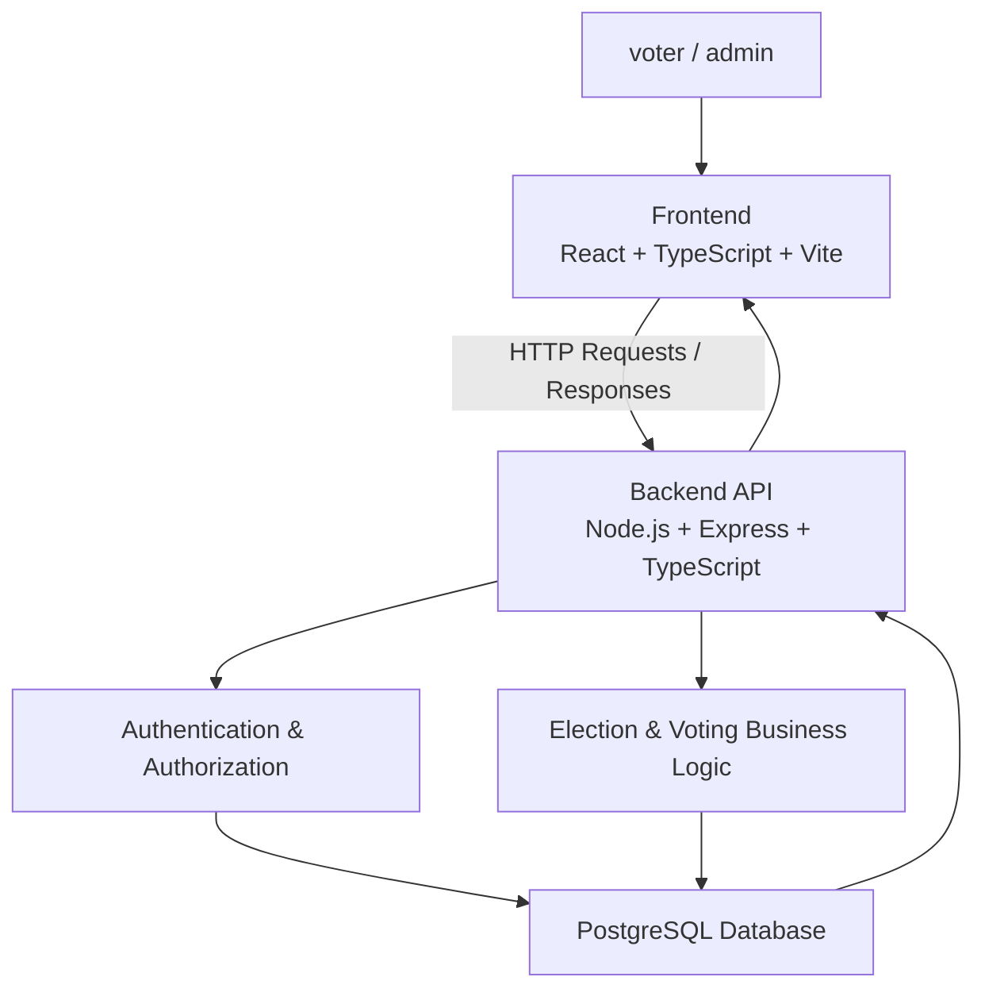
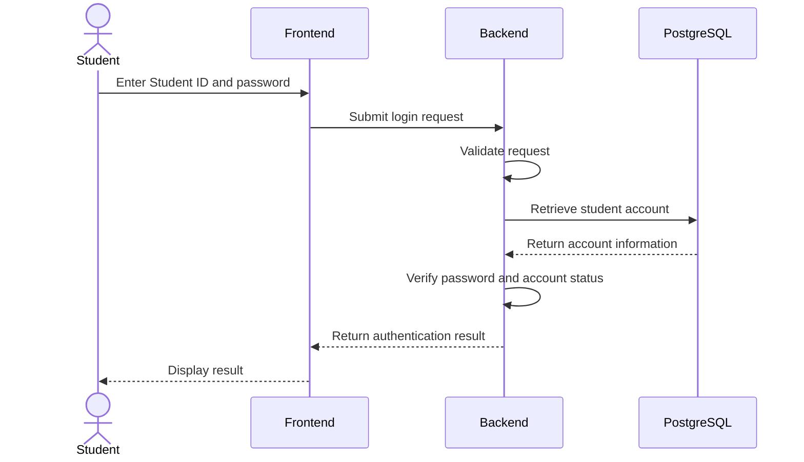
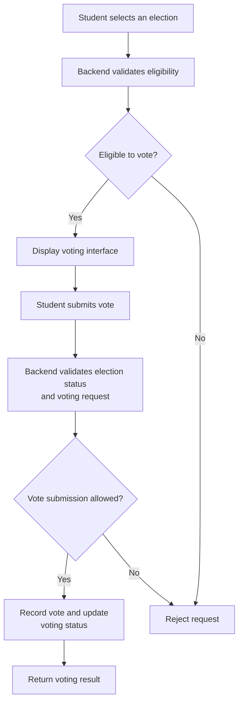

# System Architecture — eVoting V2

## 1. Overview

eVoting V2 is a full-stack school election voting website developed as a learning project. It is an improved version of the original eVoting V1 project.

The system separates the frontend, backend, and database into distinct layers. This separation helps organize application responsibilities, manage data access, and provide a foundation for future improvements in V3.

### Architecture Goals

- Separate the user interface from business logic and database operations.
- Authenticate students and control access to protected functionality.
- Manage elections, candidates, voting periods, and election results.
- Prevent duplicate voting through server-side validation.
- Protect voter privacy by separating voter identity from individual vote choices.
- Maintain a structure that can be extended and improved in future versions.

## 2. Technology Stack

| Layer | Technology | Responsibility |
|---|---|---|
| Frontend | React, TypeScript, Vite | User interface and client-side application |
| Backend | Node.js, Express.js, TypeScript | API, business logic, authentication, and authorization |
| Database | PostgreSQL | Persistent storage and relational data management |
| Database Access | `pg` | Connecting the backend to PostgreSQL |
| Authentication Support | `bcrypt` | Password hashing and verification, where implemented |

The frontend and backend are maintained in separate project directories.

## 3. High-Level Architecture



### 3.1 Frontend

The frontend provides the interface through which students and administrators interact with the system.

Its responsibilities include:

- Displaying available elections and election schedules.
- Displaying candidate information.
- Providing the student login interface.
- Allowing eligible students to submit their votes.
- Displaying voting results when permitted.
- Providing administrative interfaces for election management.

The frontend communicates with the backend through HTTP requests. It is responsible for presenting information and collecting user input, but it must not be treated as a trusted enforcement layer for security-sensitive operations.

### 3.2 Backend

The backend is responsible for processing requests and enforcing the application's business rules.

Its responsibilities include:

- Receiving and validating API requests.
- Authenticating students and administrators.
- Enforcing authorization rules.
- Retrieving and updating election and candidate information.
- Checking voting eligibility and preventing duplicate voting.
- Processing vote submissions.
- Retrieving and calculating election results.
- Interacting with PostgreSQL through the database access layer.

Security-sensitive operations must be validated on the server rather than relying solely on frontend checks.

### 3.3 Database

PostgreSQL provides persistent storage for the application's relational data.

The database is responsible for storing the information required by the implemented system, such as student identities, election information, candidates, voting eligibility, votes, and administrative records where applicable.

Database constraints and appropriate transaction handling can provide additional protection against inconsistent data and concurrent voting requests.

The exact tables, relationships, constraints, and data separation mechanisms are documented separately in `database.md`.

## 4. Main Application Workflows

### 4.1 Student Authentication



Students authenticate using a five-digit Student ID and password.

The backend is responsible for validating credentials and determining whether access should be granted. Passwords should be stored using an appropriate password-hashing mechanism rather than as plaintext.

The specific authentication response, session or token mechanism, and account-status checks depend on the implemented backend.

### 4.2 Voting Workflow



The voting process should follow these principles:

1. The backend verifies that the student is eligible to participate in the selected election.
2. The backend checks that the election is open and accepts votes.
3. The backend validates the submitted candidate or voting choice.
4. The backend prevents a student from submitting more than one valid vote for the same election.
5. Vote recording and updates to voting status should be handled consistently, preferably within an appropriate database transaction.
6. The backend returns the result of the operation to the frontend.

The exact implementation must be verified against the current source code and database design.

### 4.3 Election Management

Administrators use the administrative interface to manage elections and related information.

Depending on the implemented functionality, this may include:

- Creating and updating election information.
- Managing candidates.
- Configuring election schedules.
- Controlling election status.
- Viewing election results.

Administrative operations must be authorized by the backend. Hiding administrative controls in the frontend is not sufficient to protect them.

### 4.4 Vote Counting and Results

The system processes recorded votes to determine election results.

Result calculation should use the authoritative vote records in the database and follow the applicable election rules. Access to results should respect the intended permissions and publication schedule.

The implementation details, including how votes are counted and how ties or invalid states are handled, should be documented alongside the relevant database and API specifications.

## 5. Security and Voting Privacy

Voting privacy is an important design consideration in eVoting V2.

The architecture aims to distinguish two separate concerns:

- **Voter eligibility:** Determining who is permitted to vote and whether that person has already voted.
- **Vote records:** Recording and counting the choices submitted in an election.

These concerns should be separated as far as the system's requirements permit. The relationship between voter identity, voting status, and individual vote choices must be reviewed in the actual database schema and backend logic.

Additional security considerations include:

- Server-side authentication and authorization.
- Secure password storage.
- Input validation and parameterized database queries.
- Duplicate-voting prevention under concurrent requests.
- Appropriate database permissions and secret management.
- Careful handling of application logs to avoid exposing credentials or individual vote choices.

Although the project includes implemented and tested security measures, testing alone does not establish that the system is free from vulnerabilities. The system has not been independently security-audited.

## 6. Development Environment

The project uses a separate frontend and backend development environment.

```text
e-voting-website-v2/
├── frontend/
├── backend/
├── docs/
│   └── architecture.md
└── README.md
```

The directory layout above is illustrative and should be adjusted to match the actual repository.

PostgreSQL is used as the relational database. During development, it can run locally on the developer's machine. The backend connects to the database using its configured connection settings.

Environment-specific values, database credentials, and other secrets should be stored outside the source code and must not be committed to version control.

## 7. Design Limitations and Future Improvements

eVoting V2 is a completed learning project, not a production-certified election platform.

Potential areas for improvement in V3 include:

- Refining the separation between voter eligibility data and ballot records.
- Strengthening database constraints and transaction handling.
- Improving authentication and administrative access controls.
- Expanding automated tests and security testing.
- Improving API documentation and error handling.
- Reviewing audit logging and operational security.
- Evaluating deployment architecture and database configuration.

Any future changes should be based on the limitations identified in the existing implementation and the results of further testing.

## 8. Related Documentation

- `README.md` — Project overview, features, and setup instructions.
- `docs/database.md` — Database schema, relationships, and constraints.
- `docs/api.md` — API endpoints, request formats, and response formats.
- `docs/security-and-privacy.md` — Security controls, privacy design, and limitations.
- `docs/testing.md` — Test cases and verification results.
- `docs/decisions.md` — Architecture decisions and their rationale.
- `docs/v3-roadmap.md` — Planned improvements for the next version.

